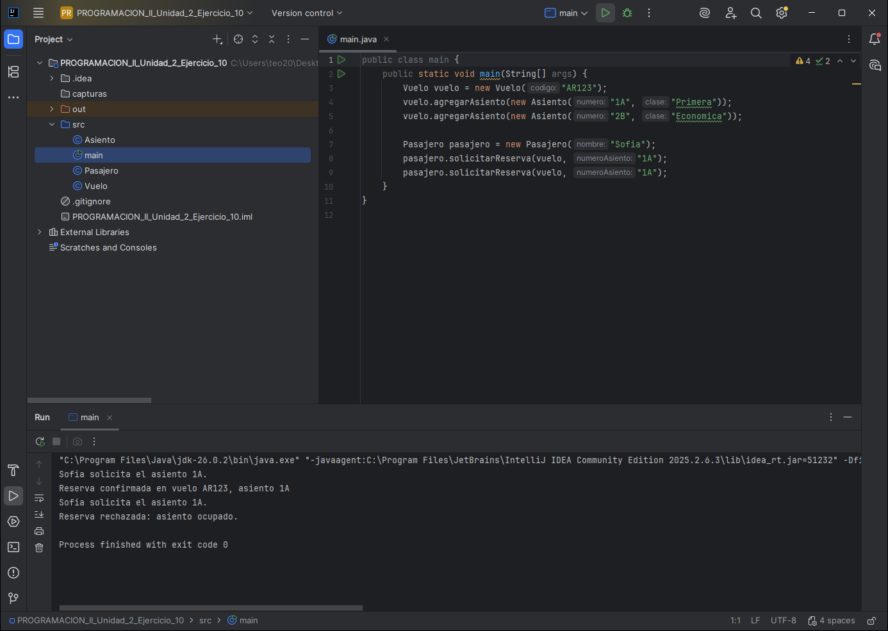

# PROGRAMACIÓN II — Unidad 2, Ejercicio 10: Sistema de Reserva de Vuelos y Validación de Asientos

Trabajo práctico de Programación II. Este repositorio contiene la resolución en Java del ejercicio 10 de la Unidad 2.

## Consigna

#### Contexto

Al momento de reservar un asiento en un vuelo comercial, el objeto Pasajero se comunica con el objeto Vuelo para solicitar la asignación de un lugar específico, requiriendo que el vuelo verifique la disponibilidad antes de confirmar la reserva.

#### Consigna

Modelar la colaboración entre un pasajero, una agencia de viajes y un vuelo, asegurando que el mensaje de reserva valide las reglas de negocio y actualice el estado del asiento correspondiente.

#### Desarrollo requerido

- Definir la clase Asiento (con número, clase y estado de ocupación) y la clase Vuelo (con un código y una colección de asientos).
- Crear la clase Pasajero que mantenga información personal y posea un método para solicitar una reserva a un vuelo dado.
- Implementar en la clase Vuelo el método reservarAsiento(String numeroAsiento) que valide si el asiento existe y está libre, cambiando su estado a ocupado en caso afirmativo.
- En el método main, instanciar un vuelo con sus respectivos asientos, crear un pasajero, ejecutar el envío del mensaje de reserva e imprimir el comprobante o el rechazo según corresponda.

## Estructura del repositorio

```
PROGRAMACION_II_Unidad_2_Ejercicio_10/
├── README.md
├── capturas/
│   └── consola.png
└── src/
    ├── Asiento.java
    ├── main.java   # clase con el método main
    ├── Pasajero.java
    └── Vuelo.java
```

## Funcionamiento y lógica

El ejercicio simula la reserva de asientos en un vuelo: el pasajero le pide un asiento al vuelo, y el vuelo controla si está libre.

### `Asiento`

Tiene `numero`, `clase` y `ocupado` (privados). Todo asiento empieza libre; con `ocupar()` se marca como ocupado.

### `Vuelo`

Tiene un `codigo` y una lista (`ArrayList`) de asientos.

- **`agregarAsiento(Asiento)`:** suma un asiento al vuelo.
- **`reservarAsiento(String numero)`:** busca el asiento en la lista. Si existe y está libre, lo ocupa, confirma la reserva y devuelve `true`. Si está ocupado o no existe, informa el rechazo y devuelve `false`.

### `Pasajero`

Su método `solicitarReserva(vuelo, numeroAsiento)` anuncia el pedido y se lo envía al vuelo llamando a `reservarAsiento()`.

### `main`

Crea el vuelo **AR123** con los asientos 1A (Primera) y 2B (Económica) y la pasajera Sofía, que pide el asiento 1A dos veces: la primera reserva se **confirma** y la segunda se **rechaza** porque el asiento ya está ocupado.

## Ejecución

Captura de la consola de IntelliJ IDEA ejecutando el programa:



Salida obtenida:

```
Sofia solicita el asiento 1A.
Reserva confirmada en vuelo AR123, asiento 1A
Sofia solicita el asiento 1A.
Reserva rechazada: asiento ocupado.
```
